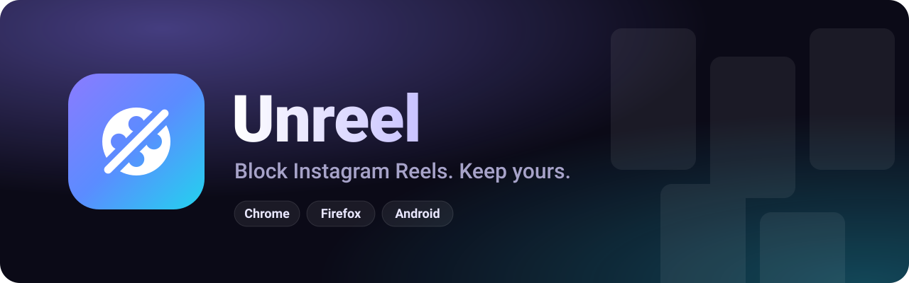
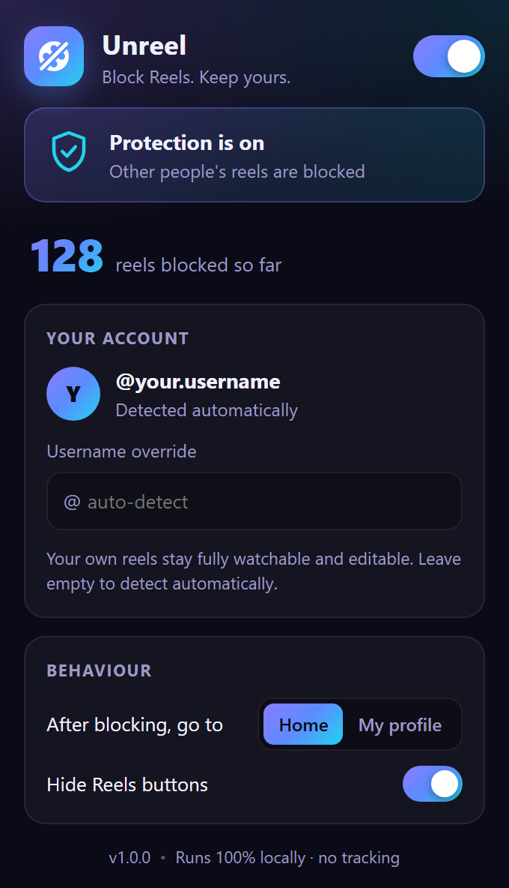

<p align="center">
  
</p>

<p align="center">
  
  
  
  
  
  
</p>

<p align="center">
  <b>Unreel</b> kicks you out of Instagram Reels — the endless feed and every reel posted by someone else —<br>
  while keeping <b>your own reels</b> fully watchable and editable.
</p>

---

## ⬇️ Download

| Platform | File | Size |
| --- | --- | --- |
| **Chrome**, Edge, Brave, Opera, Vivaldi | [`unreel-chrome-v1.0.0.zip`](releases/unreel-chrome-v1.0.0.zip) | 21 KB |
| **Firefox** (desktop & Android) | [`unreel-firefox-v1.0.0.xpi`](releases/unreel-firefox-v1.0.0.xpi) | 21 KB |
| **Android** app (Instagram app) | [`unreel-android-v1.0.0.apk`](releases/unreel-android-v1.0.0.apk) | 1 MB |

Checksums: [`releases/SHA256SUMS.txt`](releases/SHA256SUMS.txt)

---

## ✨ What it does

| On Instagram you open… | Unreel |
| --- | --- |
| The **Reels** tab / `instagram.com/reels/` | 🚫 Kicks you out |
| A reel **someone else** posted (from feed, Explore, DMs, a link…) | 🚫 Kicks you out |
| **Someone else's** profile → *Reels* tab | 🚫 Sends you to their normal grid |
| A reel **you** posted or co-posted | ✅ Stays open — watch, edit, check insights |
| **Your** profile → *Reels* tab | ✅ Stays open |
| Feed, Stories, Messages, Explore grid, profiles | ✅ Untouched |

<table>
  <tr>
    <td width="360" valign="top">
      
    </td>
    <td valign="top">
      <h3>Extension highlights</h3>
      <ul>
        <li><b>No flash of reels</b> — a “checking…” screen covers the page and pauses video until Unreel knows whose reel it is.</li>
        <li><b>Detects your account automatically</b> — or type your username manually.</li>
        <li><b>Collabs count as yours</b> — reels you co-posted are allowed.</li>
        <li><b>Hides Reels buttons</b> in the sidebar and on other people's profiles.</li>
        <li><b>Choose where to land</b> after a block: Home or your profile.</li>
        <li><b>One-click pause</b> and a counter of reels blocked.</li>
      </ul>
      <h3>Android highlights</h3>
      <ul>
        <li>Works inside the official Instagram app.</li>
        <li>Closes the Reels tab and other people's reels instantly.</li>
        <li><b>No internet permission</b> — nothing can leave your phone.</li>
      </ul>
    </td>
  </tr>
</table>

---

## 🧩 Install

### Chrome / Edge / Brave / Opera

1. Download [`unreel-chrome-v1.0.0.zip`](releases/unreel-chrome-v1.0.0.zip) and **unzip** it into a folder you will keep.
2. Open `chrome://extensions` (Edge: `edge://extensions`).
3. Turn on **Developer mode** (top-right).
4. Click **Load unpacked** and pick the unzipped folder.
5. Pin Unreel to the toolbar and open instagram.com — your username is detected automatically.

### Firefox

Firefox only installs *permanently* add-ons that are signed by Mozilla. Pick one:

- **Quick try (until restart):** open `about:debugging#/runtime/this-firefox` → **Load Temporary Add-on…** → choose [`unreel-firefox-v1.0.0.xpi`](releases/unreel-firefox-v1.0.0.xpi).
- **Permanent, unsigned:** in **Firefox Developer Edition / Nightly / ESR**, set `xpinstall.signatures.required` to `false` in `about:config`, then drag the `.xpi` into the window.
- **Permanent, signed (recommended for publishing):** upload the `.xpi` to [addons.mozilla.org](https://addons.mozilla.org/developers/) — as a listed or self-distributed (unlisted) add-on — and install the signed file Mozilla gives back.

> Works in **Firefox for Android** too, once signed.

### Android

1. Download [`unreel-android-v1.0.0.apk`](releases/unreel-android-v1.0.0.apk) on your phone and open it. Allow installing from your browser/file manager if asked.
2. Open **Unreel** → tap **Open Accessibility settings** → **Unreel — Reels blocker** → turn it **on**.
3. **Switch greyed out?** (Android 13+) Go back to Unreel → **Open App info** → **⋮** menu → **Allow restricted settings**, then repeat step 2.
4. Open Instagram and tap your **Profile** tab once — Unreel learns your username. (Or type it in the app.)

---

## ⚙️ How it works

### Browser extension

```
URL changes on instagram.com
        │
        ├─ /reels/…                 → block
        ├─ /<other>/reels/          → back to /<other>/
        ├─ /<you>/reels/            → allow
        └─ /reel/<code>/            → who posted it?
                 1. Instagram's own media API (owner + collaborators)
                 2. author link on the page
                 3. you opened it from your own profile
              yours → allow · anyone else / unknown → block
```

Everything runs in a content script on `instagram.com`. The only network requests are to `instagram.com` itself, using the session you're already logged in with. See [`extension/src/content/content.js`](extension/src/content/content.js).

### Android app

Android does not let apps change how another app behaves, so Unreel uses an **Accessibility service** restricted to the Instagram app. When Instagram shows its full-screen reel player, Unreel reads the author's username on screen:

- it's **you** → nothing happens;
- it's **someone else** → Unreel presses **Back** (or switches the Reels tab to Home);
- it **can't tell** → allowed only if you came from your own profile, otherwise blocked after ~1 s.

See [`ReelBlockerService.kt`](android/app/src/main/java/app/unreel/ReelBlockerService.kt) and [`IgScreen.kt`](android/app/src/main/java/app/unreel/IgScreen.kt).

> **If Instagram changes its app layout** and Unreel stops recognising reels, the view ids it looks for are all listed in one place: `IgScreen.Ids`. Update them and rebuild.

---

## 🔒 Privacy

No analytics, no telemetry, no servers, no accounts. The Android app doesn't even have internet permission. Full policy: [PRIVACY.md](PRIVACY.md).

---

## 🛠️ Build from source

**Requirements:** Node.js 22.2+, JDK 17, Android SDK (platform 35).

```bash
# Browser extensions → releases/unreel-chrome-*.zip and releases/unreel-firefox-*.xpi
node extension/build.mjs
```

```bash
# Android APK → android/app/build/outputs/apk/release/app-release.apk
cd android
./gradlew assembleRelease
```

Release signing is read from `android/keystore.properties` (git-ignored). Without it, the release APK is signed with the debug key so anyone can build.

```properties
storeFile=keystore/unreel-release.jks
storePassword=…
keyAlias=unreel
keyPassword=…
```

**CI:** [`.github/workflows/build.yml`](.github/workflows/build.yml) builds everything on every push and attaches the files to a GitHub Release when you push a `v*` tag. To sign in CI, add the secrets `KEYSTORE_BASE64`, `KEYSTORE_PASSWORD`, `KEY_ALIAS`, `KEY_PASSWORD`.

### Test the extension without an Instagram account

```bash
node extension/test/mock-instagram.mjs
```

Open <http://localhost:8787> — a fake Instagram that loads the real content script. Use the test links in the sidebar: your reel stays, everyone else's gets blocked.

---

## 📁 Project structure

```
unreel/
├── extension/
│   ├── src/
│   │   ├── manifest.json          # shared MV3 manifest
│   │   ├── content/               # the blocker (content.js + styles)
│   │   ├── popup/                 # toolbar popup UI
│   │   └── icons/
│   ├── test/mock-instagram.mjs    # local test server
│   └── build.mjs                  # builds Chrome .zip + Firefox .xpi (no dependencies)
├── android/
│   └── app/src/main/java/app/unreel/
│       ├── ReelBlockerService.kt  # accessibility service
│       ├── IgScreen.kt            # reads the Instagram screen (all view ids live here)
│       ├── Prefs.kt               # settings
│       └── MainActivity.kt        # Jetpack Compose UI
├── releases/                      # ready-to-install builds
├── docs/                          # banner, icon, screenshots
└── .github/workflows/build.yml    # CI + GitHub Releases
```

---

## ❓ FAQ

**Will Instagram ban me?** Unreel doesn't automate your account, post, like or scrape anything. It only navigates away from pages, like you pressing Back.

**My own reel got blocked.** Make sure your username is correct (popup / app). If you just switched accounts, open your profile once so Unreel re-detects it.

**Does it block reels in the home feed?** Reels that play inline in the feed are left alone; opening one full-screen is blocked if it isn't yours.

**Can I pause it?** Yes — the main toggle in the popup or app.

---

## ⚖️ Disclaimer

Unreel is an independent open-source project. It is **not affiliated with, endorsed by, or sponsored by Instagram or Meta Platforms, Inc.** “Instagram” and “Reels” are trademarks of Meta Platforms, Inc., used here only to describe what the software works with.

## 📄 License

[MIT](LICENSE)
